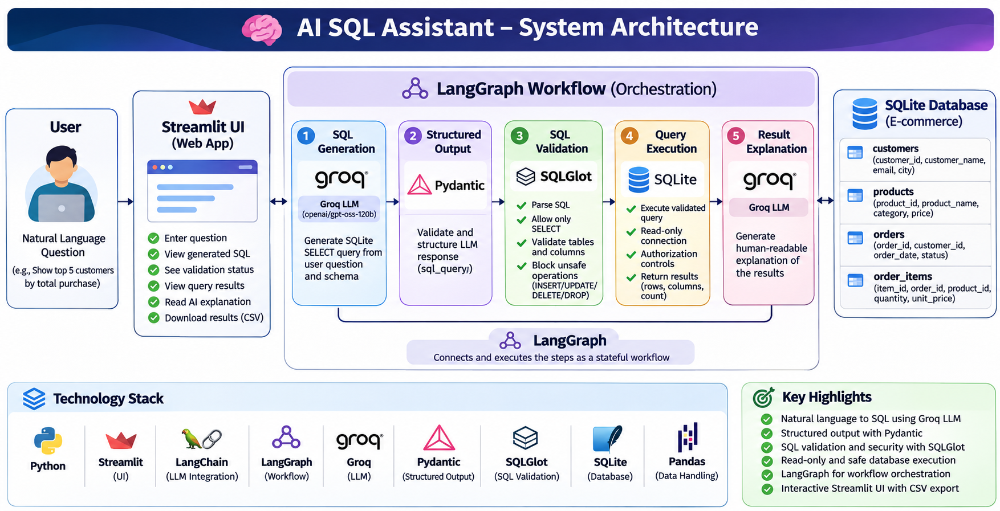

# 🧠 AI SQL Assistant

**Convert Natural Language into SQL Queries Using Generative AI and LangGraph**

AI SQL Assistant is an AI-powered application that allows users to interact with a SQLite database using natural language instead of writing SQL queries manually.

The application uses a Groq-powered LLM to generate SQL queries, validates them before execution, retrieves results from the database, and generates easy-to-understand explanations.

## 🚀 Features

- **Natural Language to SQL:** Convert plain-English questions into SQL queries.
- **LLM-powered SQL Generation:** Uses Groq LLM (`openai/gpt-oss-120b`).
- **Structured Output:** Uses Pydantic and LangChain output parsing to structure generated SQL.
- **SQL Validation:** Uses SQLGlot to parse and validate SQL queries.
- **SQL Execution:** Executes approved queries against a SQLite database.
- **Database Protection:** Uses read-only database connections and SQLite authorization controls.
- **AI Result Explanation:** Explains query results in simple English.
- **Interactive UI:** Built using Streamlit.
- **CSV Export:** Download query results as CSV.

## 🏗️ Architecture



The application uses LangGraph to orchestrate SQL generation,
structured output validation, SQL safety checks, database
execution, and AI-powered result explanation.


## 🔄 Workflow Explanation

1. **User Input:** The user enters a question in plain English.
2. **SQL Generation:** Groq generates a SQLite-compatible SELECT query using the database schema.
3. **Structured Output:** Pydantic validates the structure of the generated response.
4. **SQL Validation:** SQLGlot checks the query and rejects unsupported or unauthorized operations.
5. **SQL Execution:** Approved queries are executed against SQLite using a read-only connection.
6. **Result Explanation:** Groq analyzes the returned data and generates a human-readable explanation.
7. **Output:** Streamlit displays the generated SQL, validation status, query results, and AI explanation.

## 🛠️ Technology Stack

| Technology | Purpose |
|---|---|
| Python | Application development |
| Groq LLM | SQL generation and result explanation |
| LangChain | LLM integration and prompt management |
| LangGraph | Workflow orchestration |
| Pydantic | Structured output validation |
| SQLGlot | SQL parsing and validation |
| SQLite | Relational database |
| Streamlit | User interface |
| Pandas | Query result display and CSV export |

## 📂 Project Structure

```text
ai-sql-assistant/
│
├── data/
│   └── ecommerce.db
│
├── docs/
│
├── src/
│   ├── database.py
│   ├── graph_nodes.py
│   ├── graph_state.py
│   ├── schema_inspector.py
│   ├── sql_executor.py
│   ├── sql_generator.py
│   ├── sql_validator.py
│   └── workflow_graph.py
│
├── tests/
│   ├── test_database_security.py
│   ├── test_sql_safety.py
│   ├── test_workflow_graph.py
│   └── test_workflow_safety.py
│
├── app.py
├── requirements.txt
├── .env.example
├── .gitignore
└── README.md
```

## 🗄️ Database

The project uses a sample e-commerce database with four relational tables:

- **customers:** Customer details.
- **products:** Product information and pricing.
- **orders:** Customer order information.
- **order_items:** Individual products and quantities associated with orders.

The schema inspector dynamically retrieves table definitions, columns, and foreign-key relationships to provide context for SQL generation.

The application initializes the sample database when it starts.

## 🔐 SQL Safety and Validation

Since SQL is generated by an LLM, executing generated queries without validation can introduce security risks.

This project implements multiple protective layers:

1. SQLGlot parses the generated query.
2. Only a single SELECT statement is accepted.
3. Only approved database tables are accessible.
4. Unsupported query structures and selected dangerous functions are rejected.
5. SQLite is opened in read-only mode.
6. SQLite authorization controls restrict database operations.
7. SQLite query-only mode provides an additional safeguard.

Security tests cover attempts to execute DELETE, UPDATE, INSERT, and DROP statements.

**Note:** These controls are designed for this learning application. They should not be considered a complete security solution for production or untrusted multi-user environments.

## ⚙️ Installation and Setup

### 1. Clone the repository

```bash
git clone https://github.com/kiran-kumar-aidev/ai-sql-assistant.git
cd ai-sql-assistant
```

### 2. Create a virtual environment

```bash
python -m venv venv
```

Activate it on Windows:

```powershell
venv\Scripts\activate
```

### 3. Install dependencies

```bash
pip install -r requirements.txt
```

### 4. Configure the Groq API key

Create a `.env` file in the project root.

Add:

```env
GROQ_API_KEY=your_groq_api_key_here
```

Get your API key from the Groq developer console.

Never commit your actual `.env` file or API key to GitHub.

### 5. Run the application

```bash
streamlit run app.py
```

The application will open in your browser.

## 🧪 Running Tests

Run the tests from the project root.

**SQL validation tests:**

```bash
python -m tests.test_sql_safety
```

**Database security tests:**

```bash
python -m tests.test_database_security
```

**Workflow safety tests:**

```bash
python -m tests.test_workflow_safety
```

**End-to-end workflow test:**

```bash
python -m tests.test_workflow_graph
```

## 💡 Example Questions

Try asking the application:

- Show the top 5 customers by total purchase.
- Which products generate the highest revenue?
- Show the top 2 customers by total spending.
- List all customers from Hyderabad.
- Show the number of orders for each customer.


## 🎯 Learning Objectives

This project demonstrates practical implementation of:

- LLM-based SQL generation.
- Prompt engineering.
- Structured LLM output using Pydantic.
- Database schema inspection.
- SQL parsing and validation.
- Read-only database execution.
- LangGraph workflow orchestration.
- LLM-generated result explanations.
- Testing AI workflows and SQL safety.


## 👨‍💻 Author

**Kiran Kumar**

AI/ML and Agentic AI project portfolio.

